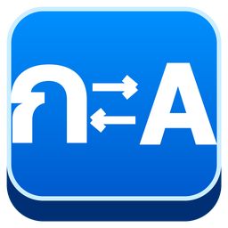
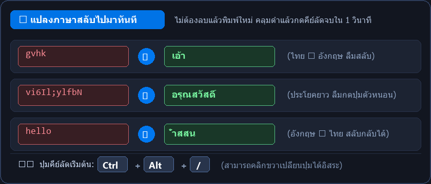
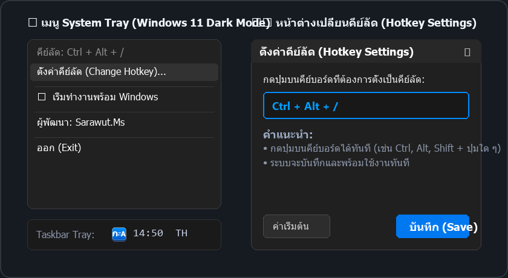

<div align="center">

  

  # Convert Language 🔄 🇹🇭/ᴇɴɢ

  **เครื่องมือแปลงภาษาข้อความ (ไทย ⇋ อังกฤษ) อัตโนมัติบน Windows เมื่อลืมสลับแป้นพิมพ์**  
  *ทำงานเงียบ ๆ บน System Tray • แปลงข้อความทันใจใน 1 วินาที • ไม่ต้องติดตั้ง (Portable)*

  [](https://github.com/sarawutms/convert-language/releases/latest)
  [](LICENSE)
  [](https://github.com/sarawutms/convert-language)

</div>

---

<div align="center">
  
</div>

---

## ✨ ฟีเจอร์เด่น (Features)

- 🎨 **ไอคอน 3D Keycap สไตล์ Windows 11 (ก ⇄ A):** ไอคอนแอปคมชัดทุกขนาด (16px - 256px) พร้อมแสดงบน Taskbar System Tray อย่างโดดเด่น
- 🌓 **ดีไซน์เมนูตาม Windows (Dark / Light Theme):** เมนู System Tray และหน้าต่างตั้งค่าปรับสีตามธีมของ Windows 10/11 อัตโนมัติ (Dark Mode สีดำเรียบหรู / Light Mode สีขาวสะอาดตา) สไตล์ Modern Flat พร้อมขอบโค้งมน
- ⌨️ **เปลี่ยนปุ่มคีย์ลัดได้ง่าย ๆ จาก System Tray:** คลิกขวาที่ไอคอนแล้วเลือก **"ตั้งค่าคีย์ลัด (Change Hotkey)..."** กดปุ่มบนคีย์บอร์ดที่ต้องการแล้วบันทึกได้ทันที
- ⚡ **เป็นไฟล์ `.exe` ตัวเดียวจบ (Single Executable):** รวมทุกอย่างในไฟล์เดียว ไม่ต้องพึ่งพา PowerShell หรือสคริปต์ภายนอก
- 🤫 **เปิดใช้งานเงียบสนิท (100% Silent):** ไม่มีหน้าต่าง Terminal หรือ Command Prompt สีดำกระพริบขึ้นมาเลย
- 🚀 **ตั้งค่าเริ่มพร้อม Windows ใน 1 คลิก:** คลิกขวาที่ไอคอน System Tray แล้วติ๊กถูกที่ **"เริ่มทำงานพร้อม Windows"** ได้ทันที
- 🔄 **แปลงภาษาสลับไปมาอัตโนมัติ:** ตรวจจับสัดส่วนตัวอักษรไทย-อังกฤษในข้อความ แล้วแปลงสลับภาษาให้อัตโนมัติ
- 🎯 **คีย์ลัด Global Hotkey:** กดแปลงได้จากทุกโปรแกรมทันที (ค่าเริ่มต้น **`Ctrl + Alt + /`** หรือปรับเปลี่ยนได้ตามใจชอบ กิน CPU **0%** ตลอดเวลาที่ไม่ได้กด)
- 🔤 **ครอบคลุมทุกปุ่มบนคีย์บอร์ด:** รองรับทั้งปุ่มปกติและปุ่ม Shift (รวมทั้งหมด 94 อักขระ) ตามผังแป้นพิมพ์เกษมณี (Kedmanee) และ US QWERTY
- 🛡️ **ระบบ Single Instance:** ป้องกันการเปิดโปรแกรมซ้ำซ้อน
- 🪟 **ทำงานบน System Tray:** ทำงานอยู่เบื้องหลังพร้อมไอคอนบน Taskbar System Tray ไม่รกหน้าจอ

---

## 📸 ภาพตัวอย่างหน้าจอ (Screenshots)

<div align="center">
  
</div>

---

## 🛠️ ความต้องการของระบบ (Requirements)

- **ระบบปฏิบัติการ:** Windows 10 หรือ Windows 11 ทุกรุ่น
- **.NET Framework:** 4.0 ขึ้นไป (มีมาให้พร้อมกับ Windows ทุกเครื่องอยู่แล้ว)

---

## 📥 วิธีเริ่มต้นใช้งาน (Getting Started)

### 1. ดาวน์โหลดโปรแกรม
- ดาวน์โหลดไฟล์ **`ConvertLanguage-v1.0.0.zip`** จากหน้า [Releases](https://github.com/sarawutms/convert-language/releases/latest)
- แตกไฟล์ ZIP แล้วดับเบิลคลิก **`ConvertLanguage.exe`** ใช้งานได้ทันที (ไม่ต้องติดตั้ง)

หรือโคลนโปรเจกต์ด้วย Git:
```bash
git clone https://github.com/sarawutms/convert-language.git
```

### 2. เริ่มต้นใช้งาน
ดับเบิลคลิกที่ไฟล์ **`ConvertLanguage.exe`** ได้ทันที

- โปรแกรมจะเริ่มทำงานเงียบ ๆ บน **System Tray** (มุมขวาล่างข้างนาฬิกา หรือในปุ่มลูกศร `^`)
- จะมีข้อความแจ้งเตือน **"พร้อมใช้งาน!"** ขึ้นมาที่มุมขวาล่าง

### 3. วิธีการใช้งาน
1. ใช้เมาส์คลุมดำ (Highlight) ข้อความที่ต้องการแปลง
2. กดคีย์ลัด (ค่าเริ่มต้น **`Ctrl + Alt + /`**)
3. ข้อความจะถูกแปลงเป็นอีกภาษาทันที 🎉

> **ตัวอย่าง:**
> - ไฮไลต์ `gvhk` แล้วกดคีย์ลัด ➔ จะกลายเป็น `เอ้า`
> - ไฮไลต์ `vi6Il;ylfbN` แล้วกดคีย์ลัด ➔ จะกลายเป็น `อรุณสวัสดิ์`
> - ไฮไลต์ `hello` แล้วกดคีย์ลัด ➔ จะกลายเป็น `้ำสสน`
> - ไฮไลต์ `กะอกราด` แล้วกดคีย์ลัด ➔ จะกลายเป็น `dtvdikf`

---

## ⌨️ วิธีเปลี่ยนปุ่มคีย์ลัด (Change Hotkey)

1. คลิกขวาที่ไอคอนโปรแกรมบน **System Tray** (มุมขวาล่างข้างนาฬิกา)
2. เลือกเมนู **`ตั้งค่าคีย์ลัด (Change Hotkey)...`**
3. คลิกที่ช่องข้อความ แล้วกดปุ่มคีย์ลัดใหม่บนแป้นพิมพ์ตามที่ต้องการ (เช่น `Ctrl + Shift + X`, `Alt + Space` หรือปุ่มอื่น ๆ)
4. กดปุ่ม **"บันทึก (Save)"** เพื่อใช้งานคีย์ลัดใหม่ได้ทันที!

*(หากต้องการกลับไปใช้ค่าเริ่มต้น ให้กดปุ่ม **"ค่าเริ่มต้น"**)*

---

## ⚙️ ตั้งค่าให้เปิดใช้งานอัตโนมัติตอนเปิดเครื่อง (Run on Startup)

1. คลิกขวาที่ไอคอนโปรแกรมบน **System Tray**
2. คลิกเลือก **`เริ่มทำงานพร้อม Windows (Run on Startup)`** ให้มีเครื่องหมายถูก ✔️

---

## 📁 โครงสร้างโปรเจกต์ (Project Structure)

```text
ConvertLanguageTray/
├── assets/                     # รูปภาพตัวอย่างและไอคอนสำหรับ README
│   ├── icon.png                # ไอคอนหลักขนาด 256x256
│   ├── demo_card.png           # กราฟิกแสดงตัวอย่าง Before & After
│   └── preview_ui.png          # ภาพตัวอย่างเมนู System Tray และหน้าต่างตั้งค่า
├── src/
│   ├── Program.cs              # ซอร์สโค้ดภาษา C# .NET
│   ├── generate_sharp_icon.py  # สคริปต์สร้าง app.ico ครบทุกขนาด
│   └── generate_readme_assets.py # สคริปต์สร้างรูปภาพ assets
├── ConvertLanguage.exe         # ตัวโปรแกรมหลัก (ดับเบิลคลิกใช้งานได้ทันที)
├── app.ico                     # ไฟล์ไอคอน Multi-resolution (16px - 256px)
├── build.bat                   # สคริปต์คอมไพล์โปรแกรม
└── README.md                   # คู่มือการใช้งาน
```

---

## 🔨 วิธีการคอมไพล์ซอร์สโค้ดใหม่ (Build from Source)

หากต้องการแก้ไขโค้ดหรือคอมไพล์ด้วยตัวเอง สามารถดับเบิลคลิกที่ไฟล์ **`build.bat`** ได้ทันที ตัวสคริปต์จะใช้ `csc.exe` ที่มีอยู่ใน Windows ในการคอมไพล์ออกมาเป็น `ConvertLanguage.exe` ใหม่พร้อมฝังไอคอนให้อัตโนมัติ

---

## 🚪 วิธีปิดโปรแกรม (Exit)

คลิกขวาที่ไอคอนโปรแกรมบน **System Tray** แล้วเลือก **"ออก (Exit)"**

---

## 👨‍💻 ผู้พัฒนา (Author & Credits)

- **ผู้พัฒนา:** **Sarawut.Ms**
- **GitHub:** [@sarawutms](https://github.com/sarawutms)
- **Repository:** [convert-language](https://github.com/sarawutms/convert-language)

---

## 📝 License

โปรเจกต์นี้เปิดให้ใช้งานและแก้ไขได้อย่างอิสระภายใต้ [MIT License](LICENSE)  
Copyright © 2026 **Sarawut.Ms**. All rights reserved.
